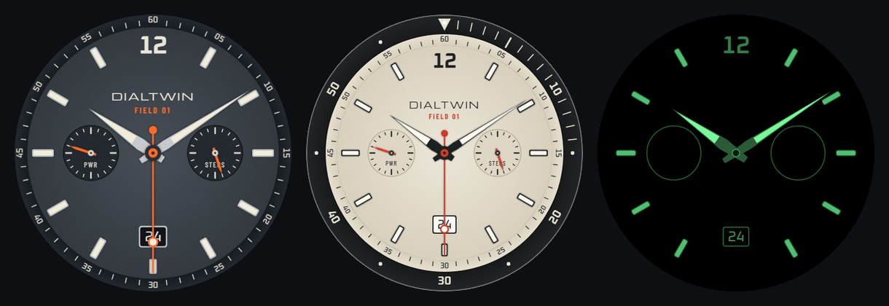

# Dialtwin

Paste a link to a watch you own, get a matching watch face for your Wear OS smartwatch, for your own wrist.

Dialtwin fetches the product page and lets a team of Claude agents do the rest. A scout picks
the best dial photo and measures it. A builder draws the dial as code. Two critics score each
round against the photo and against the rules for a good smartwatch face. The best round is
packaged as a real [Watch Face Format](https://developer.android.com/training/wearables/wff) app
and installed on your watch over Wi-Fi.

It runs on your own machine with **your own Claude access**. Nothing is hosted, and nobody else
pays for your tokens.



## What you need
- A Linux machine with Docker (a home server or a Raspberry Pi 5 is fine). On macOS or Windows see
  [Docker Desktop](#docker-desktop-macos-windows).
- A round **Wear OS** watch: Galaxy Watch 4 or newer, Pixel Watch, or others with Wear OS 4+.
- A **Claude Pro or Max subscription**. Run `claude setup-token` with
  [Claude Code](https://docs.claude.com/en/docs/claude-code) installed and paste the token into `.env`.
  Use it for yourself, within Anthropic's terms.

### What it costs
Nothing extra: Dialtwin only runs on your Claude subscription and **does not accept API keys**.
A face takes 30–90 minutes and roughly **15–30 million tokens**, most of them cache reads. At API
prices that would be around US$20 a face, so per-token billing is switched off on purpose.

The tokens count towards your plan's usage limits:
- **Max** is recommended.
- **Pro** works, but a job may hit the usage limit partway through. Once the limit resets, press
  **Continue** on the job page to carry on.

`MAX_TOKENS_PER_JOB` (default 40M) stops a runaway job, and every job page shows the tokens it used.

## Quick start
```bash
git clone https://github.com/STEELRNRG/dialtwin.git && cd dialtwin
cp .env.example .env          # add CLAUDE_CODE_OAUTH_TOKEN (from `claude setup-token`)
docker build -f Dockerfile.base -t dialtwin-base .    # once; downloads the Android tools (~15 min)
docker compose up -d --build
```
Open http://localhost:8097.

The UI has **no login**. It listens on localhost only unless you set `HOST=0.0.0.0` in `.env`.
Only do that on a network you trust, and never expose it to the internet.

## Pair your watch (once)
1. On the watch: Settings → About watch → Software → tap *Software version* 7 times to unlock
   Developer options.
2. Developer options → turn on **ADB debugging** and **Wireless debugging** → *Pair new device*.
3. In Dialtwin open **Watch**, type the IP:port and the pairing code the watch shows.

To install, open Wireless debugging on the watch and keep that screen on. Watches drop to
power-save Wi-Fi as soon as the screen sleeps, and then they can't be found. Then press
**Install on my watch** on a finished face. The face appears in your watch's face picker.

## How a face is made
1. **Fetch**: headless Chromium saves the page text, a screenshot and the product images.
2. **Scout** (Opus) picks a straight-on daylight photo per colourway (up to 3), crops and measures it,
   and writes a brief. **You check the photos** before anything is built.
3. **Rounds** (default up to 5):
   - The **builder** (Opus) writes `face.js`, a parametric SVG drawing of the dial
     ([contract](engine/CONTRACT.md)).
   - A **fidelity critic** (Opus) compares the render with the photo.
   - A **watch critic** (Sonnet) checks legibility, Always-On power use and packaging risks.
   - Stops at fidelity ≥ 8 and wearability ≥ 7.5, or when the scores stop improving.
4. **Package**: layers → Watch Face Format v2 XML, validated against the official schema →
   signed APK → Google's memory-footprint check.
5. **Install** over wireless adb.

**Improve it** on a job page takes plain feedback ("thicker hands", "the red is too orange")
and runs more rounds.

Every face gets watch settings for colourway, layout (full dial or painted bezel), Always-On
colour (green lume or red night vision), and live or parked registers (battery and steps) when
the dial has subdials.

## Legal: please read
Dialtwin is a tool that runs on your own computer. It doesn't host, sell or share watch faces,
and nothing it makes leaves your machine unless you send it somewhere.

- **Faces leave out brand names, logos and model names.** The agents are told to recreate the
  dial's layout, hands and colours and to leave every maker's mark off.
- **Watch designs belong to their makers.** Make faces of watches you own, for your own wrist.
  **Don't publish, sell, upload or share faces of other companies' designs**, on Google Play,
  Facer or anywhere else. Watch brands enforce their rights against smartwatch copies: Swatch
  Group won a UK case against Samsung over watch faces in its store, and Cartier sued Apple over
  look-alike watch apps. If you want to share a face, design an original one.
- **Respect websites' terms.** Dialtwin fetches the page you give it, like your browser does. Don't
  point it at sites that forbid automated access, and don't use it to collect images in bulk.
- **Your Claude account, your responsibility.** Your use of Claude is under Anthropic's terms.
  Dialtwin runs on your own subscription, for your own use.
- **No warranty.** Dialtwin is provided as-is under the MIT licence. You're responsible for how you
  use it and what you make with it. This section is not legal advice.

**Brand owners:** if anything in this repository concerns you, please
[open an issue](https://github.com/STEELRNRG/dialtwin/issues) and it will be dealt with promptly.

Dialtwin isn't affiliated with or endorsed by Google, Samsung, Anthropic or any watch company.
"Wear OS" is a trademark of Google LLC. Other names belong to their owners.

## Settings
All settings live in `.env`; see [.env.example](.env.example).

| Setting | Default | What it does |
|---|---|---|
| `CLAUDE_CODE_OAUTH_TOKEN` | | Your Claude subscription token (`claude setup-token`). API keys are ignored |
| `MAX_TOKENS_PER_JOB` | 40000000 | Stop a job past this many tokens (0 = no limit) |
| `HOST` / `PORT` | 127.0.0.1 / 8097 | Where the UI listens |
| `STUDIO_URL` | http://localhost:8097 | Your address for the UI, used in notification links |
| `PACKAGE_PREFIX` | com.dialtwin.face | Android package prefix; keep it fixed so rebuilds update in place |
| `IDEAS_DAILY` | 0 | 1 = run the ideas scout every morning (~3M tokens a run) |
| `NOTIFY_URL` | | POST a notification here, e.g. `https://ntfy.sh/<your-topic>` |
| `HA_URL`, `HA_TOKEN`, `HA_NOTIFY_TARGETS` | | Home Assistant notifications instead of, or as well as, ntfy |
| `TZ` | UTC | Time zone for the daily ideas scan |

## Docker Desktop (macOS, Windows)
The compose file uses host networking so adb can find the watch over mDNS. On Docker Desktop
turn on host networking (Settings → Resources → Network, Docker Desktop 4.34+). Otherwise,
replace `network_mode: host` with `ports: ["127.0.0.1:8097:8097"]`, set `HOST=0.0.0.0`, and
type the watch's IP:port on the Watch page each time instead of relying on discovery.

## Other smartwatches
Only Wear OS is supported today. The engine draws every face as layers plus a list of hands, so
other platforms need an exporter, not a rewrite:

| Platform | Status |
|---|---|
| Wear OS (Samsung, Pixel, others) | ✅ Supported |
| Pebble (Core Devices) | Planned: open platform, good fit |
| Amazfit / Zepp OS | Planned |
| Garmin Connect IQ | Possible, more work (Monkey C) |
| Apple Watch | ❌ Apple doesn't allow custom watch faces |
| Fitbit | ❌ Third-party faces are being wound down |

Pull requests for an exporter are very welcome.

## Project layout
```
engine/      renderer and packager, no Claude needed: face.html, render.mjs, export.mjs,
             package.py, build_apk.sh, fetch_page.mjs, fonts/, xsd/ (WFF v2), CONTRACT.md,
             examples/fieldchrono/ (the worked example the builder learns from)
studio/      FastAPI app and job worker: app.py, pipeline.py, claude.py, adb.py, notify.py,
             ideas.py, config.py, agents/*.md (the agents' instructions), templates/
```
Runtime folders (git-ignored): `jobs/` (one folder per face, including every agent's log),
`data/` (database, APK signing key), `adb/` (watch pairing keys), `claude-home/`.

Try the engine without Claude: copy `engine/examples/fieldchrono/face.js` into an empty folder and
run `node /app/engine/render.mjs r1` there inside the container.

## Support the project
Dialtwin is free and MIT-licensed. If it made you a face you love, you can
[sponsor it on GitHub](https://github.com/sponsors/STEELRNRG).

## Credits
- Watch Face Format schema: © Samsung Electronics and Google, Apache 2.0.
- Memory-footprint checker: [google/watchface](https://github.com/google/watchface), Apache 2.0
  (downloaded during the Docker build).
- Fonts: Google Fonts, SIL Open Font License 1.1 (licence texts in `engine/fonts/licenses/`). See [NOTICE](NOTICE).

